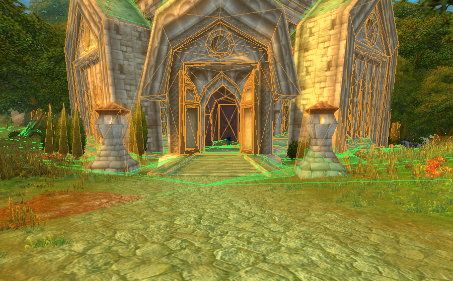

# Features

## Client

- [CASC bypass](./client/casc-bypass.md)
- [Certificate bypass](./client/cert-bypass.md)
- [vmap/mmap debug overlay](./client/debug-overlay.md)
- [Shader utilities](./client/shader-utilities.md)
- [Control server](./client/control-server.md), so agents can launch and control the client

## [Server](./server.md)

- Windows and Linux support
- Most basic gameplay systems working: spells, transports, flight paths, vendors, trainers, auction house and more
- Login flow fixed

## [Extractors](./extractors.md)

- Target 1.15
- Range-based or incremental extraction

## [Bots](./bots.md)

- Real (network) botting framework for conformance and stability testing
